

  

<h1 align="center">Campuslit</h1>

<b>The Bahria University LMS and CMS, finally pleasant to use.</b> 
A free Chrome extension that redesigns the student portals you already use. 
Same logins. Same data. A whole new look.

  
  &nbsp;
  

  
  
  
  
  

  <a href="https://campuslit-bu.vercel.app/">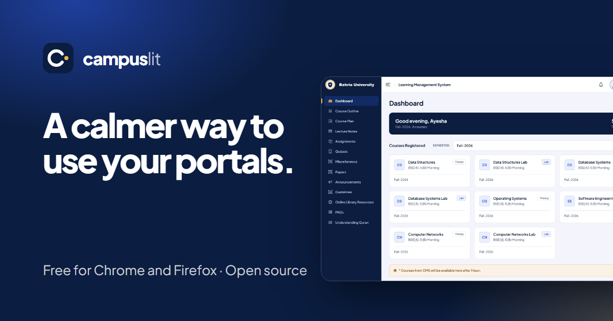</a>

> **Unofficial.** Campuslit is an independent student project. It is not made, endorsed or supported by Bahria University. It works on every Bahria campus because every campus uses the same two portals: `lms.bahria.edu.pk` and `cms.bahria.edu.pk`.

## Before and after

Drag the slider on the [website](https://campuslit-bu.vercel.app/) to compare. Every picture here is the real extension drawn on **invented sample data**, never a real student.

<table>
  <tr>
    <td width="50%"><b>Before</b>: the LMS today 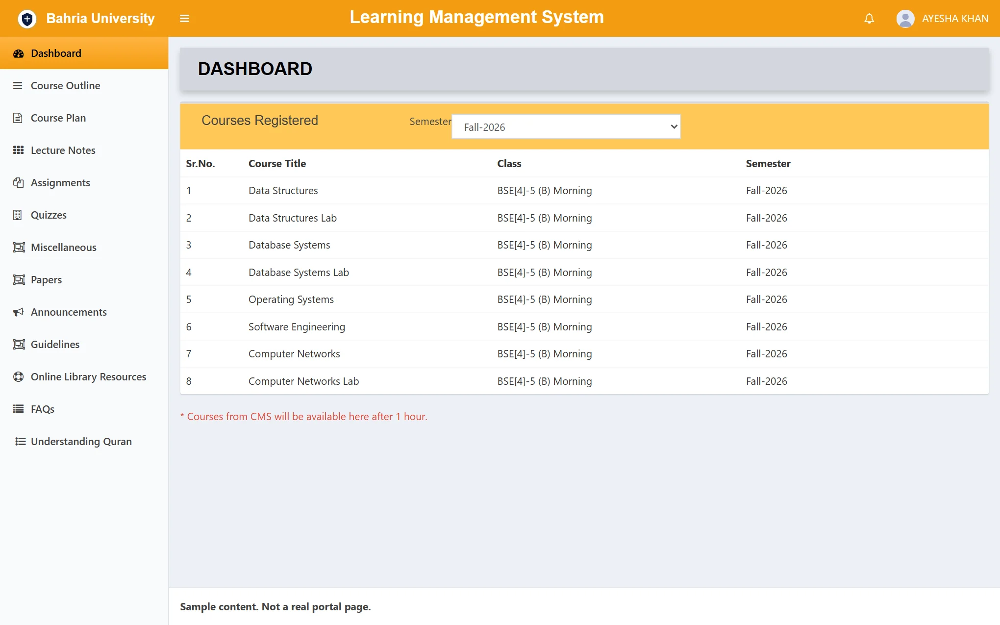</td>
    <td width="50%"><b>After</b>: with Campuslit 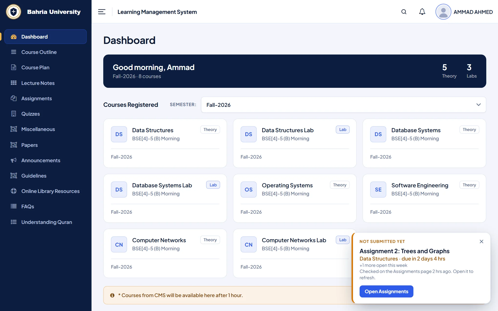</td>
  </tr>
</table>

## Why students install it

| | |
| --- | --- |
| **A calmer look** | The LMS and CMS redrawn with clean cards, tables and menus, plus a sign-in that fits one screen. |
| **Never miss a deadline** | A *Due soon* card counts down to your next assignment, and a small reminder follows you around the LMS. |
| **Attendance, explained** | One bar per course and a plain line: how many hours you can still miss, or must attend, to finish above 75%. |
| **A time table you can read** | A week calendar or day list with your next class on top, and *Add to calendar* for Google, Apple or Outlook. |
| **Hear about it first** | Optional desktop notifications: attendance marked (present or absent), quiz marks uploaded, new assignments, new lecture notes, and deadline reminders 2 days, 24 hours and 7 hours before. Off until you turn them on. |
| **Jump anywhere** | Press <kbd>Ctrl</kbd> + <kbd>K</kbd> (or <kbd>/</kbd>), type a few letters, press Enter. It forgives typos. |
| **Make it yours** | Six hand-tuned themes and a custom-theme maker, with your own text size, spacing and typeface. |
| **Private by design** | No accounts, no analytics, **sends nothing to anyone**. It never reads your password or what you type. |

## See it

<table>
  <tr>
    <td width="50%"><b>Assignments</b>: Due soon card and a status on every row 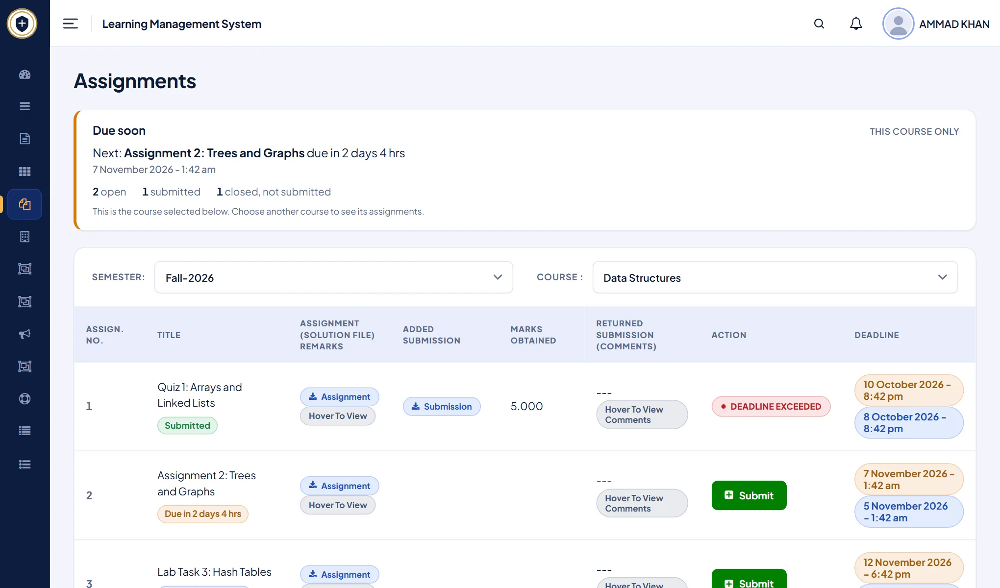</td>
    <td width="50%"><b>Attendance planner</b>: how many hours you can still miss 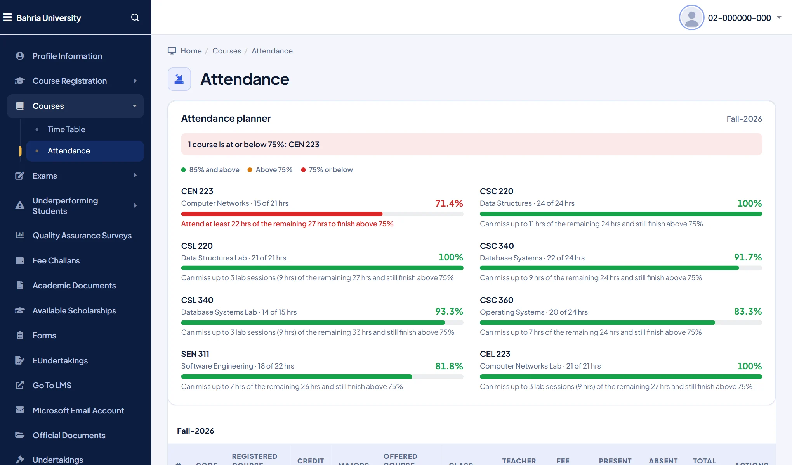</td>
  </tr>
  <tr>
    <td width="50%"><b>Time table</b>: a week you can read, with Add to calendar 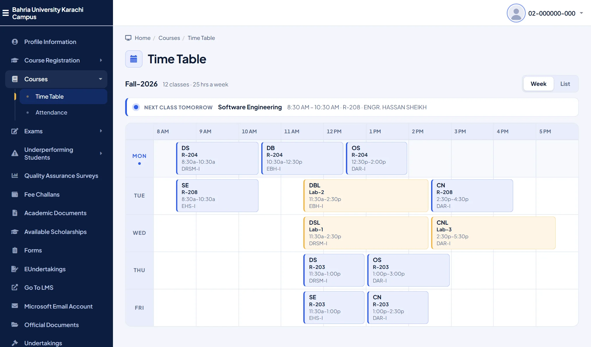</td>
    <td width="50%"><b>Quick search</b>: <kbd>Ctrl</kbd> + <kbd>K</kbd> from any page 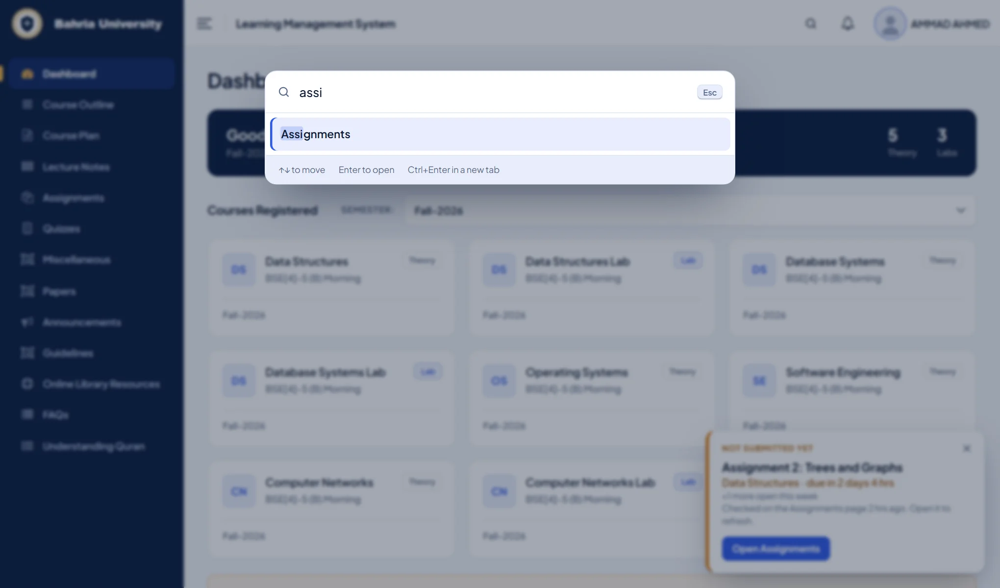</td>
  </tr>
</table>

### Six themes and a custom one

<table>
  <tr>
    <td align="center" width="33%"> <b>Bahria</b></td>
    <td align="center" width="33%">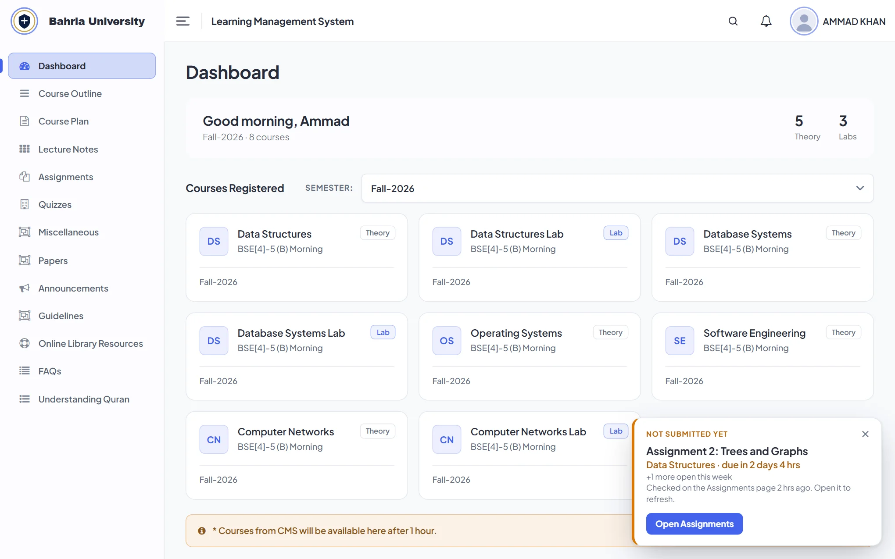 <b>Crystal</b></td>
    <td align="center" width="33%">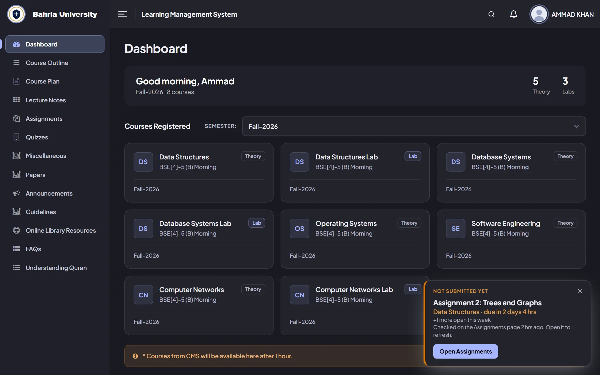 <b>Midnight</b></td>
  </tr>
  <tr>
    <td align="center">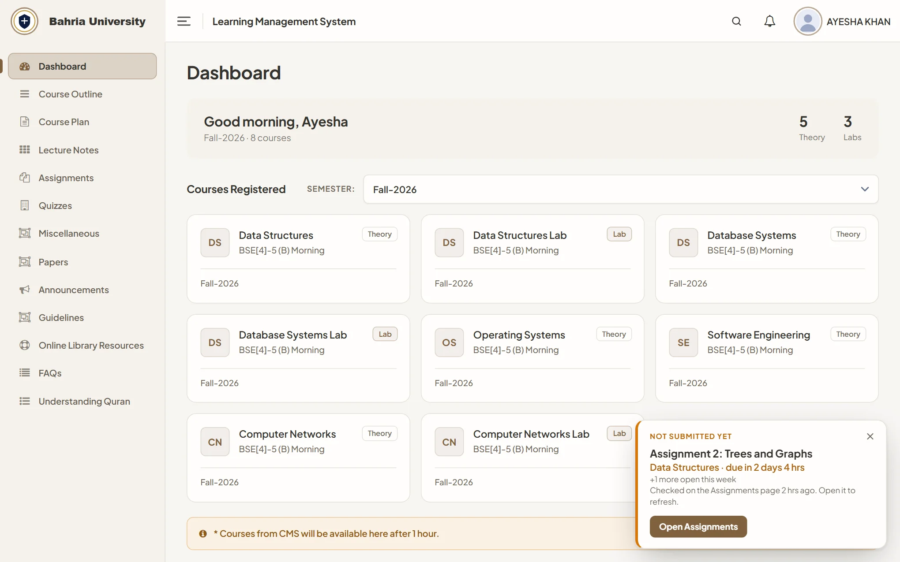 <b>Linen</b></td>
    <td align="center">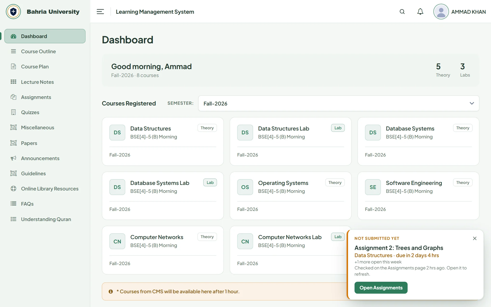 <b>Grove</b></td>
    <td align="center">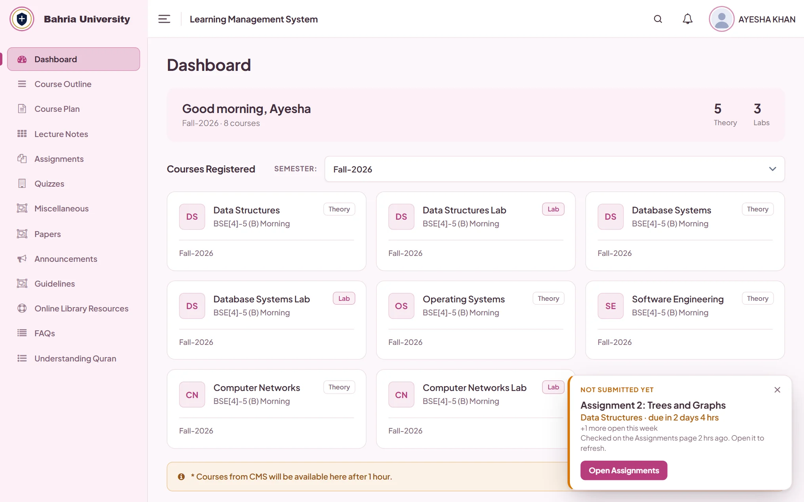 <b>Bloom</b></td>
  </tr>
</table>

### One click away

The toolbar button switches themes and turns Campuslit off for the CMS, the LMS or both. The first time, a short tour shows you around (skip it any time).

  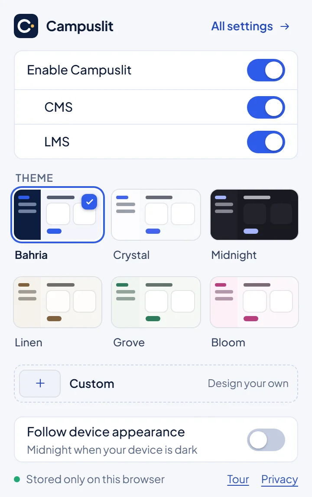
  &nbsp;&nbsp;&nbsp;
  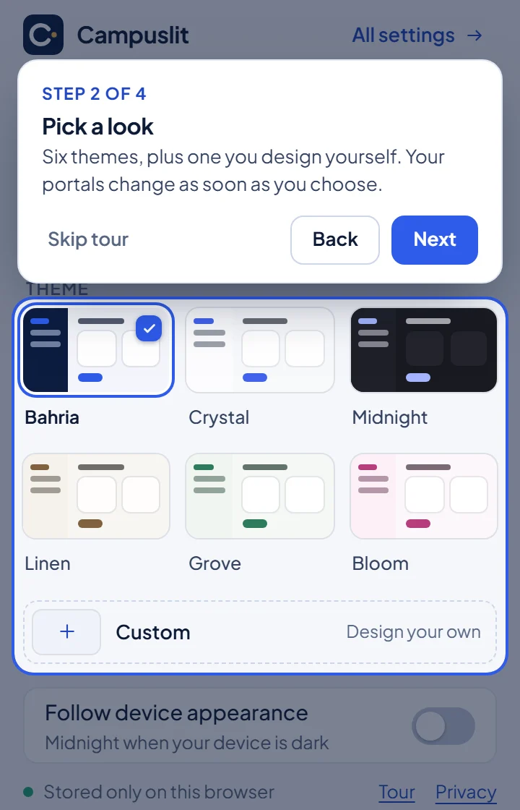

## Get it

| Browser | How |
| --- | --- |
| **Chrome, Edge, Brave** | **[Add to Chrome from the Chrome Web Store](https://chromewebstore.google.com/detail/kldmhhiopdefjapkebnelablimikghio)**, then open your CMS or LMS and sign in as usual. Pin the Campuslit button to your toolbar. |
| **Firefox 140+** | Not on Firefox Add-ons yet. Load the zip from the [latest release](https://github.com/ahmedammad1709/campuslit/releases/latest) (see *Manual install from a zip* below). |

Switch it off from the toolbar button, or remove the extension, and the original portal is back instantly. It works on a computer; most phone browsers do not run extensions like this.

## Trust, in four lines

- **It sends nothing to us or anyone else.** The extension has no server, no accounts and no analytics. Out of the box it makes no requests at all; only if you turn on the optional notifications does it open pages on the two portals, with your own sign-in. Only your look settings, optional notes (open assignments for reminders, what the notifications last saw) and a few "tip seen" flags stay on your device.
- **It only runs on** `cms.bahria.edu.pk` and `lms.bahria.edu.pk`, and asks for the single browser permission `storage`.
- **It changes how pages look**, not what they do. Forms, uploads, marks and submissions still go to the university exactly as before.
- **It is open source (MIT)**, so you can check all of the above in this repository. Read the [privacy policy](https://campuslit-bu.vercel.app/privacy).

## Links

[Website](https://campuslit-bu.vercel.app/) · [Bahria LMS redesign](https://campuslit-bu.vercel.app/bahria-lms) · [Bahria CMS: attendance planner and time table](https://campuslit-bu.vercel.app/bahria-cms) · [Privacy policy](https://campuslit-bu.vercel.app/privacy) · [Report a problem](https://github.com/ahmedammad1709/campuslit/issues) · [Chrome Web Store](https://chromewebstore.google.com/detail/kldmhhiopdefjapkebnelablimikghio)

If a screen at your campus looks wrong, please [open an issue](https://github.com/ahmedammad1709/campuslit/issues) with a screenshot (hide your name and enrollment number first). Pages change; reports keep Campuslit working.

---

<b>Everything it does (the full feature list)</b>

- **LMS** (`lms.bahria.edu.pk`): redesigned header, resizable sidebar that marks the page you are on, filter bars, tables, status pills and dropdowns; a dashboard with your courses as cards; tap-or-keyboard popovers instead of hover-only comments.
- **CMS** (`cms.bahria.edu.pk`): a unified header and sidebar with icons, tidier tables, forms and modals, clear error alerts, a role-card landing page and a one-screen student sign-in.
- **Notifications** (optional, off by default): in Settings, Notifications, choose what to hear about. While your browser is open and you are signed in, a small background worker looks at the same pages you would open (each course's assignments, quizzes and lecture notes on the LMS, and the CMS dashboard's attendance) every 1 to 8 hours, compares them with the last look on your device, and shows a desktop notification for what is new: attendance marked present or absent, quiz marks uploaded, a new assignment (or its marks), a new lecture note, and deadline reminders 2 days, 24 hours and 7 hours before. It uses your own session, never sees a password, and talks only to the two portals. If the session ends it tells you once.
- **Assignments due-soon card**: on the LMS Assignments page, a card at the top names the next open deadline and counts it down ("due in 2 days 4 hrs"), with a status under each assignment (Submitted, Due in..., Closed). It covers the course selected on the page, because the portal shows one course at a time. It reads only what the page already shows and makes no requests.
- **Quick search**: press Ctrl+K (Cmd+K on a Mac) or `/`, or tap the search button in the header, type a few letters and jump to any page in the menu. It understands related words ("gpa" finds Provisional Result, "homework" finds Assignments), forgives typos, shows which menu a page lives in, and only ever lists ordinary pages on bahria.edu.pk. It reads the menu links already on the page, keeps nothing and sends nothing; Settings can turn it off.
- **Time table to calendar**: an "Add to calendar" button on the CMS Time Table page downloads your classes as a calendar file (`.ics`). Each class repeats weekly in Pakistan time until the end date you choose, with an optional reminder; opening the file again updates the events instead of duplicating them. The file is built in your browser from the schedule on the page and saved as a download; nothing is uploaded.
- **Welcome, tour and one-time hints**: the first time you open the toolbar popup it plays a short animated welcome and offers a four-step tour (a spotlight on the switches, the themes, "follow device" and All settings, with a Skip button at every step; Esc skips too). The footer's **Tour** link and Settings' **Take the tour again** replay it. On the portals, the first time a Campuslit feature appears (Assignments card, time-table export, attendance planner, quick search) one small hint points at it, once each and never more than one per page. The Guide page in settings describes every feature. Settings can turn tips off, show the hints again, and turn the opening animation off. What has been shown is a few yes/no flags in extension storage.
- **Assignment reminder popup**: on other LMS pages, a small popup names the next assignment you have not submitted (within a week) and counts it down. Cross it away and it stays hidden for a few hours. To know about other courses it keeps a short note on your device (course, title, deadline of open assignments); it is never sent anywhere, and Settings can turn reminders off (which deletes the note) or forget it.
- **Attendance planner**: per-course rows on the CMS dashboard and a planner card on the Attendance page, with a plain line under each course ("Can miss up to 11 hrs of the remaining 24 hrs and still finish above 75%"). It uses your credit hours (hours per week; a lab is a 3-hour session per credit hour) and the semester length you set, to count the hours left. Attendance must be more than 75%; 75.0% exactly is not enough. The course at risk is named in a banner; and a **Time Table** as a compact day board or a one-page week calendar with a "next class" card.
- **A settings page with a live preview** built from real-structure CMS and LMS sample pages (invented data), drawn by the very stylesheets the portals get, so what you pick is exactly what you see.
- **Six themes** (Bahria, Crystal, Midnight, Linen, Grove, Bloom) **plus a custom-theme maker for your own seventh**: pick a brand color and a mode and it generates a full coherent palette (or start from a preset and change any color), with a live readability check and one-click fix, undo, and a name. Custom accent, bundled fonts (Plus Jakarta Sans, Manrope, Sora, Inter), text size, spacing and corner radius. One master switch plus a CMS and an LMS switch in the popup turn everything, or just one portal, on or off.

## Build from source

1. `npm run build` (Node.js 22 or later, no dependencies).
2. Chrome: `chrome://extensions` → Developer mode → **Load unpacked** → `dist/chrome`.
   Firefox: `about:debugging#/runtime/this-firefox` → **Load Temporary Add-on** → `dist/firefox/manifest.json`.
3. After rebuilding, press the reload icon on the extension card, then refresh the portal tab.

## Manual install from a zip

Download `campuslit-chrome.zip` or `campuslit-firefox.zip` from the latest GitHub release, unzip it somewhere you will keep it, and load it as above (Chrome: **Load unpacked** on the unzipped folder; Firefox: **Load Temporary Add-on** on its `manifest.json`). Step-by-step instructions for students are on the site.

## Making a release

`npm run package` builds both browsers, audits every file that would ship (permissions, portal-only matching, no network or `eval`, no private files, no personal-data patterns, manifest limits), zips them with `manifest.json` at the root, reads each zip back to prove it matches, and writes `dist/release/campuslit-chrome.zip`, `campuslit-firefox.zip` and `SHA256SUMS.txt`. `npm run store-assets` makes the store screenshots and promo tile from the invented sample pages. The full checklist and the store listing text are in `docs/RELEASE.md` and `docs/STORE_LISTING.md`.

## Privacy

No analytics, no accounts, no remote code or fonts, nothing sent anywhere (with notifications off the extension makes no requests; with them on it only opens pages on the two portals, with your own session), no access to passwords or to the portals' own form values. Only appearance preferences are stored, in the browser's extension storage, plus the optional assignment-reminder note described above and a few yes/no flags for the tips you have seen. To redraw a few screens it reads figures the page already shows (greeting name, LMS course list, CMS attendance hours and time table) in memory only; nothing is saved or sent. Full text: `extension/privacy.html`.

## Repository layout

| Path | What is in it |
| --- | --- |
| `extension/` | The extension: `themes.js` (palettes, custom-theme maths), `studio.js` (the custom-theme UI), `content.js` (per-site switch), `lms.*`, `cms.*`, `login.*` (portal redesigns), `portal.css` (fallback styles), `options.*` and `popup.*` (settings UI), `fonts/`, `icons/` |
| `brand/` | Logo (`logo.svg`, `logo-512.png`); regenerate with `python scripts/make-logo.py` |
| `extension/preview/` | Sample CMS and LMS pages for the settings preview; regenerate with `python scripts/make-preview-pages.py` |
| `site/` | The public website at https://campuslit-bu.vercel.app/ : home, privacy policy, licence and a 404 page (static HTML/CSS/JS, no build step, deploys as-is on Vercel with root directory `site`; security headers and clean URLs are in `site/vercel.json`). Checks: `npm test` (`tests/site.test.cjs`: metadata, links, pictures, security policy, policy text matches the extension) and `npm run test:site` (real browser: slider, gallery, menu, logo animation, no sideways scroll). Screenshots are real renders of the extension on invented sample data: `npm run preview`, then `node scripts/make-site-shots.mjs`. Preview: `node scripts/site-tools.mjs serve`; screenshots: `node scripts/make-site-shots.mjs`; share image: `node scripts/site-tools.mjs og` |
| `scripts/build.mjs` | Builds `dist/chrome` and `dist/firefox` |
| `scripts/package.mjs`, `scripts/lib/` | Release zips: `zip.mjs` (writer/reader), `audit.mjs` (what may ship), both unit-tested in `tests/package.test.cjs` (`npm run package`) |
| `scripts/store-assets.mjs` | Store screenshots and promo tile from the sample pages (`npm run store-assets`) |
| `scripts/firefox-check.mjs` | Smoke test in real Firefox: installs the built add-on over WebDriver BiDi and checks both portals (`npm run build`, then `npm run test:firefox`) |
| `scripts/browser-check.mjs` | Headless-Chrome check of the settings page, custom theme maker, popup and preview (`npm run preview`, then `npm run test:browser`) |
| `scripts/extension-check.mjs` | End-to-end check with the real built extension loaded into Chrome and fake portals (`npm run build`, then `npm run test:extension`) |
| `tests/` | `npm test` (Node's built-in runner) |
| `docs/` | Design notes, coverage matrix, validation and release checklists |
| `scripts/lms-preview`, `scripts/cms-preview` | Optional local harnesses to screenshot the redesign against pages you saved yourself (see below) |

## Working on the redesign

The portals need a sign-in, so there are no saved pages in this repository. To iterate visually, save pages from your own session (Ctrl+S, "Webpage, HTML only") into a local `html_pages/` folder (git-ignored), then run `node scripts/cms-preview/serve.mjs` or `node scripts/lms-preview/serve.mjs`. The harnesses expect the portals' public front-end files in git-ignored `vendor/` folders (the CMS's `Aspire.min.css`, fonts and images; Bootstrap 3, AdminLTE 2 and Font Awesome for the LMS) and blank enrollment numbers; add your own name with `PREVIEW_REDACT="FIRST LAST"`. Never commit saved pages, screenshots of signed-in pages, or browser profiles.

`docs/COVERAGE.md` lists exactly which pages and states have been verified. Please read it before claiming a page works.

## Licence

MIT, see `LICENSE`. The bundled fonts keep their own SIL Open Font Licence. The portals' own pages, stylesheets and logos are not part of this project and are not included.

## Credits

Plus Jakarta Sans, Manrope, Sora and Inter are bundled under the SIL Open Font License (see `extension/fonts/`). The settings preview also bundles Bootstrap 3, AdminLTE 2 and Font Awesome for its sample pages; notices are in `extension/preview/vendor/LICENSES.txt`.
